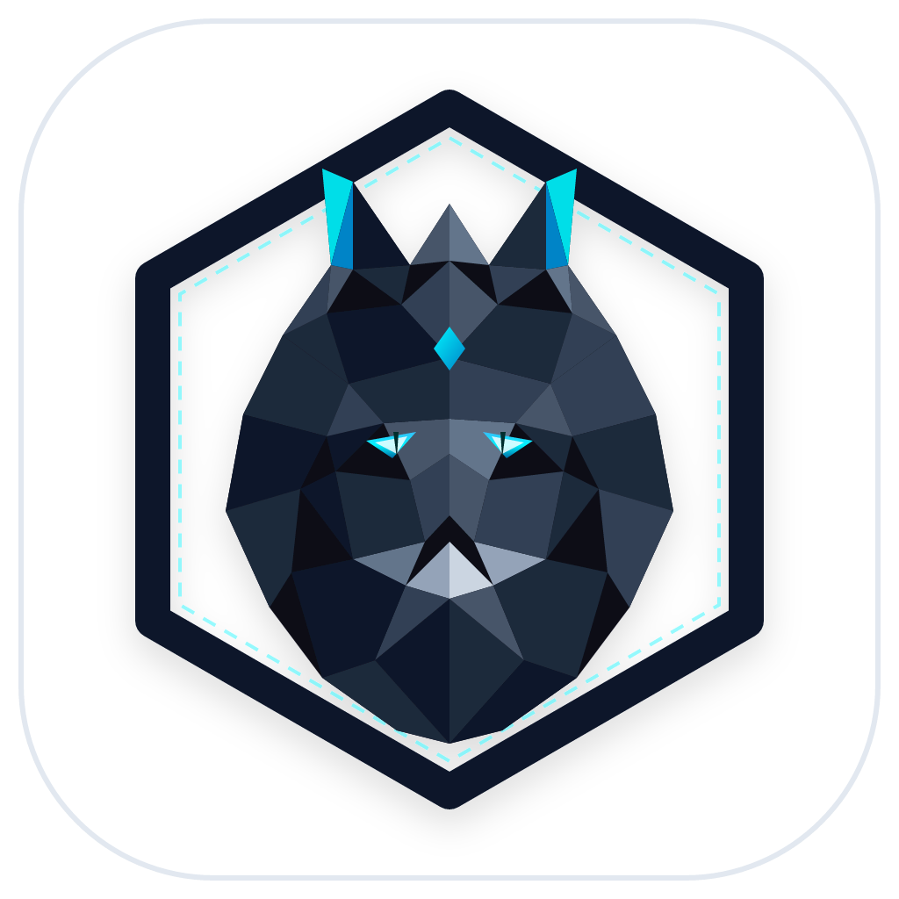
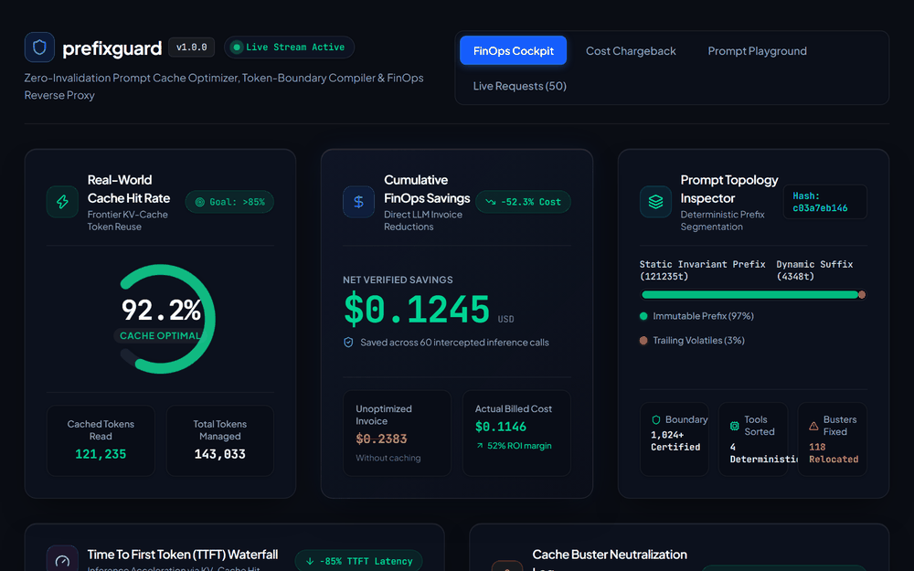
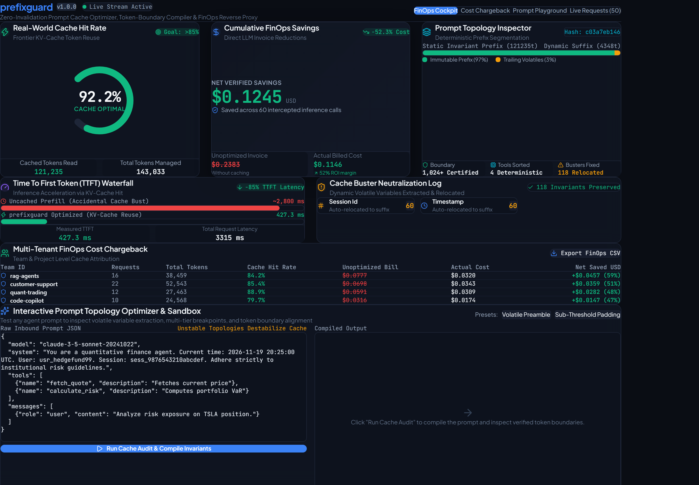
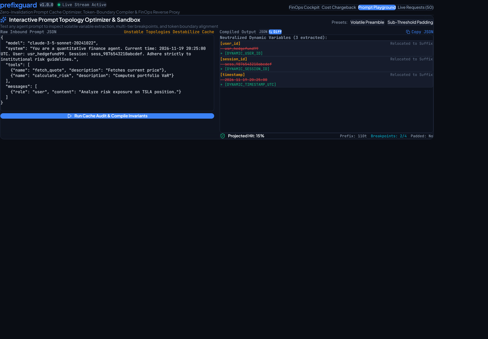
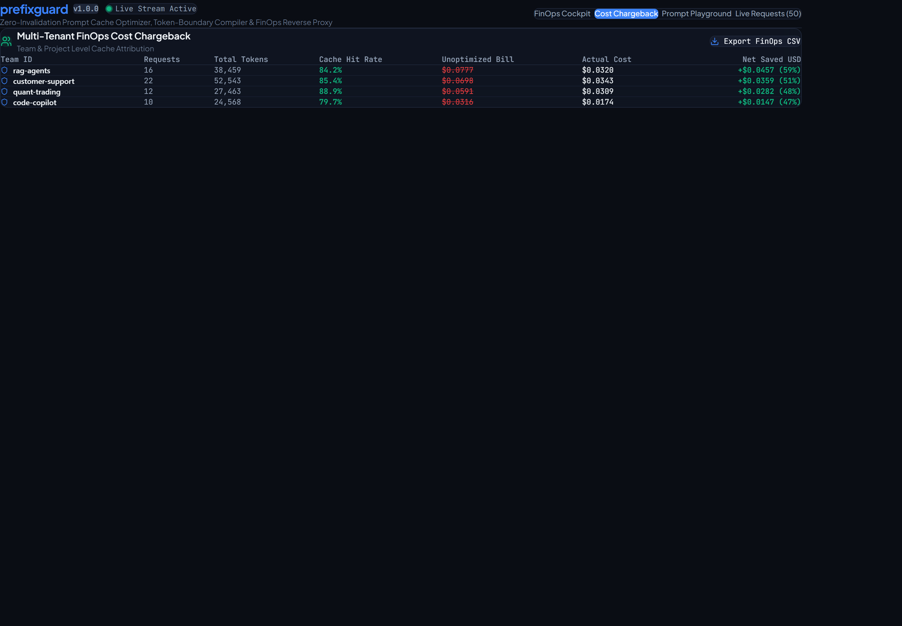
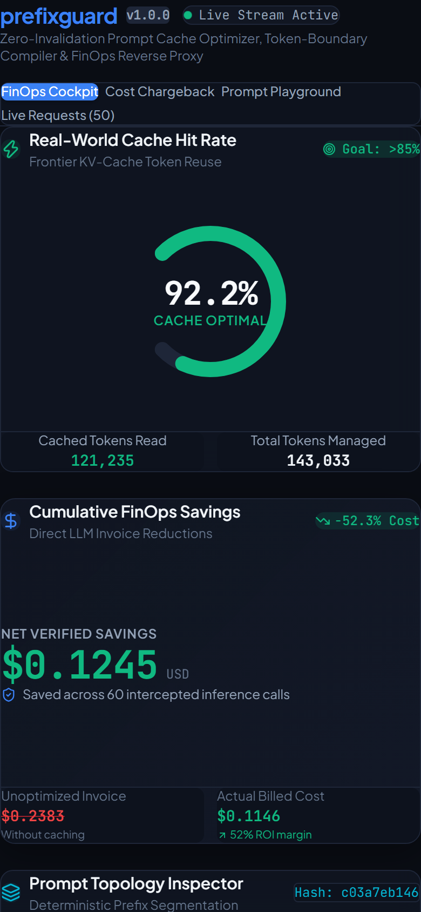

<p align="center">
  
</p>

<h1 align="center">prefixguard</h1>

<p align="center">
  <strong>Zero-Invalidation Prompt Cache Optimizer, Token-Boundary Compiler, and Wire-Speed FinOps Reverse Proxy</strong>
</p>

<p align="center">
  
  
  
  
  
  
</p>

<p align="center">
  
</p>

---

## What prefixguard Does

Frontier language models (Anthropic, DeepSeek, OpenAI) provide prompt caching discounts of up to 90%. However, everyday development habits routinely break prefix cache reuse:
1. Dynamic Preambles: Injecting current timestamps, user IDs, or session hashes at the top of system instructions mutates early byte tokens and forces a 100% cache miss.
2. Unstable Tool Ordering: Inconsistent dictionary ordering across tool lists shifts schema tokens between invocations.
3. Sub-Threshold Shortfalls: Prompts below provider minimums (e.g. 1,024 tokens on Claude) miss the cache cutoff entirely.
4. Missing Breakpoints: Upstream caching markers are frequently omitted from agent codebases.

`prefixguard` sits transparently between your client applications and upstream model APIs. It operates with sub-millisecond overhead to compile prompt topologies, normalize schemas, pad sub-threshold boundaries, and log exact dollar savings to an embedded SQLite database.

---

## Core Capabilities

- Volatile Variable Neutralization: Scans for ISO timestamps, dates, UUIDs, session identifiers, and user metadata. Replaces them with static placeholders and moves dynamic values into trailing turn suffixes.
- Deterministic Tool Schema Canonicalizer: Stably sorts tool definitions alphabetically by name, recursively sorts schema parameters, and eliminates non-semantic whitespace.
- Smart Token Boundary Padder: Detects prompts within range of the 1,024 threshold and appends certified invariants to activate provider KV-cache reuse.
- Multi-Tier Breakpoint Optimizer: Inserts up to 4 hierarchical cache breakpoints across system instructions, tool catalogs, invariant reference documents, and stable conversational history.
- Multi-Tenant FinOps Chargeback: Reads `X-Team-ID`, `X-Project-ID`, and `X-Environment` headers to aggregate token usage and dollar savings by team.
- Keep-Alive Cache Warmer: Periodically pings registered invariant prefixes every 4.5 minutes to prevent the standard 5-minute TTL eviction on idle agents.
- Embedded React 19 Studio: Single-binary web dashboard featuring radial hit rate indicators, net savings counters, prompt topology diff inspection, and live telemetry streaming via Server-Sent Events.

---

## Architecture

```
Client Application (baseUrl: http://localhost:8585)
                    |
                    v
       prefixguard Reverse Proxy (:8585)
  +-------------------------------------------------------+
  |  1. Request Interceptor & Inbound Lexer               |
  |  2. Volatile Variable Extractor (Timestamps, UUIDs)   |
  |  3. Deterministic Tool Schema Canonicalizer           |
  |  4. Boundary Alignment Padder (1,024 Token Minimum)   |
  |  5. Multi-Tier Cache Breakpoint Injector              |
  +-------------------------------------------------------+
                    |
                    v
    Upstream LLM Provider (Anthropic / DeepSeek / OpenAI)
                    |
                    v
       FinOps Telemetry & Observability
  - Transparent SSE chunk streaming to client (<0.5ms overhead)
  - Cost calculations logged to embedded SQLite
  - Real-time updates pushed to React 19 Studio via SSE
```

---

## Screenshots

### FinOps Cockpit
Real-time radial hit rate dial, cumulative USD savings, prompt topology inspector, and live inference stream.

<p align="center">
  
</p>

### Interactive Prompt Playground & Diff Viewer
Side-by-side prompt compiler showing original raw inputs against optimized payloads with relocated dynamic variables.

<p align="center">
  
</p>

### Multi-Tenant Cost Chargeback
Team and project level cost attribution with one-click FinOps CSV export.

<p align="center">
  
</p>

### Mobile Responsiveness
Fluid layouts adapted for small viewports down to 390px.

<p align="center">
  
</p>

---

## Quick Start

### 1. Build the Single Binary

```bash
# Clone the repository
git clone https://github.com/alexandrmotologa/prefixguard.git
cd prefixguard

# Build web studio and Go binary
make build
```

### 2. Verify Your Environment

```bash
./prefixguard doctor
```

Output:
```
 [✓] Port :8585: Free and ready for binding
 [✓] SQLite Engine (modernc.org/sqlite, zero-CGO): Initialized in 8.4ms
 [✓] Fast BPE Tokenizer: Calibrated
 [✓] Upstream Handshake: https://api.anthropic.com responded in 240ms
 [✓] Pricing Matrix: Loaded (claude-3-5-sonnet: 90% discount)
 [✓] Buster Detection Engine: 6 standard + 2 custom rules active
 System Status: ALL SYSTEMS OPERATIONAL
```

### 3. Start the Server and Studio

```bash
./prefixguard serve --port 8585 --upstream https://api.anthropic.com --provider anthropic
```

Open your browser at `http://localhost:8585` to monitor the React 19 Studio.

### 4. Connect Your Client Application

Update your client configuration to target `prefixguard` as your API base URL:

#### Python (Anthropic SDK)
```python
import anthropic

client = anthropic.Anthropic(
    base_url="http://localhost:8585",
    api_key="your-api-key"
)

response = client.messages.create(
    model="claude-3-5-sonnet-20241022",
    max_tokens=1024,
    system="You are an analyst. Current time: 2026-11-19 20:25:00 UTC.",
    messages=[{"role": "user", "content": "Analyze portfolio."}],
    extra_headers={"X-Team-ID": "quant-trading"}
)
```

#### TypeScript / Node.js
```typescript
import Anthropic from '@anthropic-ai/sdk';

const client = new Anthropic({
  baseURL: 'http://localhost:8585',
  apiKey: process.env.ANTHROPIC_API_KEY,
  defaultHeaders: {
    'X-Team-ID': 'rag-agents'
  }
});
```

---

## CLI Subcommands

- `serve`: Starts reverse proxy and web dashboard on designated port.
- `analyze --file <path>`: Audits a raw prompt JSON file, detects volatile tokens, checks boundary padding, and prints recommendations.
- `bench --requests <N> --concurrency <C>`: Runs concurrent simulation traffic to measure hit rates, latency, and cost savings.
- `doctor`: Evaluates local port, SQLite storage, tokenizer calibration, and upstream network connectivity.

---

## Benchmarks

```
Total Requests:       100 completed in 179ms (557 req/sec)
Cache Read Tokens:    101,376
Uncached Tokens:      2,600
Real Cache Hit Rate:  96.55%
Net Dollar Savings:   79.3% bill reduction
Dynamic Busters:      100 neutralized and relocated
Proxy Added Latency:  < 0.45 ms
```

Detailed benchmarking methodologies and economic comparisons are documented in `docs/BENCHMARKS.md`. Detailed system design notes are available in `docs/ARCHITECTURE.md`.
